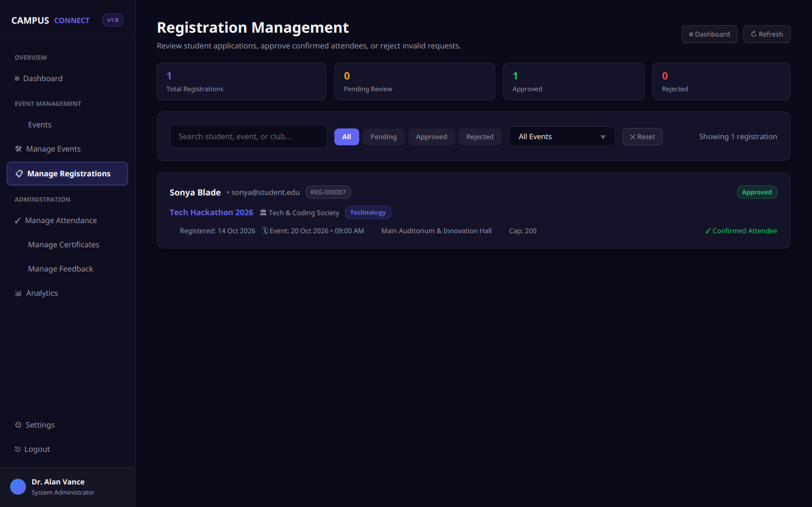
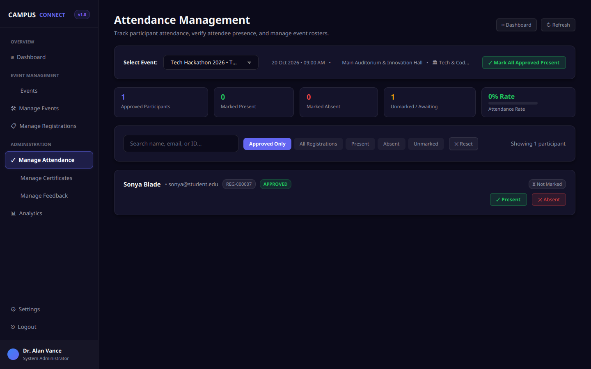
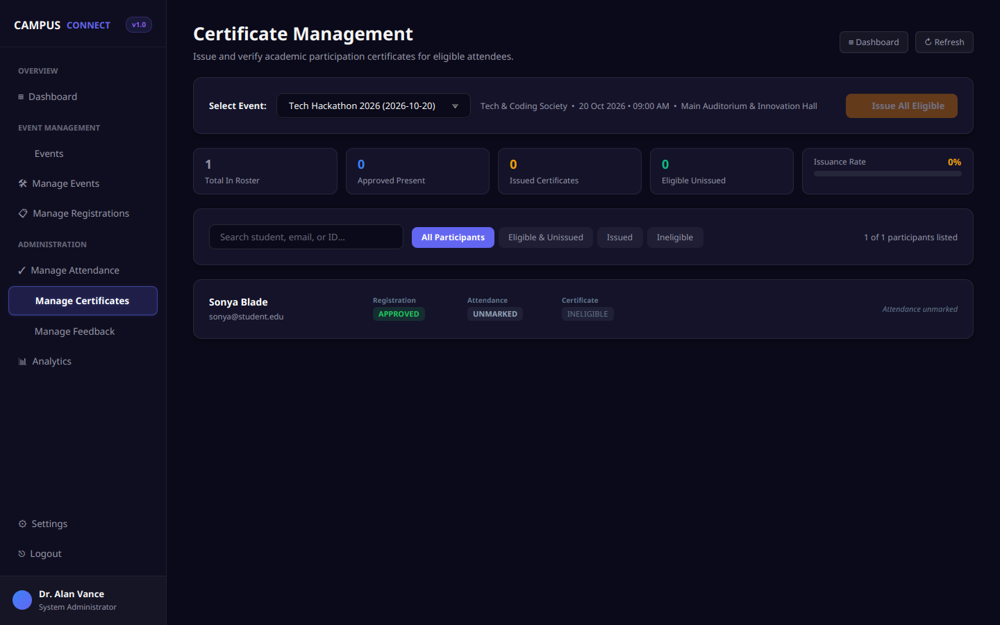

# Campus Connect ◈
### University Campus Event & Club Management System

**Repository Classification:** Private Academic & Portfolio Repository
**Academic Course:** Advanced Java Programming
**Technology Stack:** Java 21 (LTS) | JavaFX 21.0.6 | Pure JDBC | Supabase PostgreSQL 15+ (with MySQL 8.0+ support) | Apache Maven 3.9+
**Architecture:** Model-View-Controller (MVC) with Data Access Object (DAO) and Service Business Logic Layers
**Styling:** Custom Modern Dark SaaS Theme (`#0B0A1A`, `#14132A`, `#6366F1`, `#8B5CF6`) via Pure JavaFX CSS
**Governance & Security:** [Security Policy](SECURITY.md) | [Changelog](CHANGELOG.md) | [Documentation Index](#13-documentation-index)

> [!NOTE]
> **Private Repository Notice:** This repository is maintained as a **private GitHub repository** for academic coursework evaluation, university submission, and personal portfolio demonstration. All credentials, database secrets, and environment tokens are strictly isolated in local configuration files and excluded from Git version control.

---

## 1. Project Overview & Problem Statement

### The Problem
In collegiate environments, student clubs and extra-curricular event workflows are often fragmented across unconnected spreadsheets, social media group chats, paper signup sheets, and manual certificate distribution. This causes:
- **Low student awareness and missed registration deadlines** due to the lack of a centralized event directory.
- **Overbooking and capacity violations** resulting from unmanaged registration queues.
- **Duplicate registrations** that distort turnout planning and venue bookings.
- **Unverified certificate claims** issued without attendance verification.
- **Administrative fatigue** among club coordinators managing registrations, rosters, and feedback manually.
- **Absence of analytics** to measure student participation trends, club engagement, and satisfaction scores.

### The Solution: Campus Connect
**Campus Connect** provides an integrated, high-performance desktop software system tailored for collegiate environments:
- **Centralized Event Catalog:** Searchable and category-filtered campus event directory with live seat meters and deadline enforcement.
- **Role-Separated Dashboards:** Tailored user experiences for students and administrators with strict session isolation.
- **Structured Registration & Moderation:** Real-time duplicate prevention, automated capacity checks, and approval/rejection moderation.
- **Verified Attendance & Certificate Issuance:** Attendance verification checkpoint strictly gating certificate generation with unique verification hashes.
- **Actionable Analytics & Campus Pulse:** Turnout calculations, satisfaction scores, category breakdowns, and gamified student achievement badges.
- **Cloud & Offline Resilience:** Cloud persistence via **Supabase PostgreSQL** over SSL with automated fallback degradation during offline execution.

---

## 2. Intended Users & Key Features

### For Students (`STUDENT` Role)
- **Authentication & Profile:** Secure sign-in with salted PBKDF2 password verification and thread-safe session isolation.
- **Student Dashboard:** Real-time KPI summaries (Registered Events, Approved Count, Certificates Earned, Reviews Submitted) and upcoming event alerts.
- **Event Discovery & Filtering:** Live keyword search by title/description, club category filters (All, Technology, Robotics, Arts, Business), and detailed event modals (date, time, venue, club, capacity status, deadline).
- **One-Click Event Registration:** Duplicate registration prevention, deadline validation, and capacity enforcement.
- **My Events:** Unified tracking of personal registrations across status states (`PENDING`, `APPROVED`, `REJECTED`), with self-service registration cancellation for non-approved entries.
- **My Certificates:** Digital repository of verified certificates issued to the student, complete with verification codes, event details, and credential display.
- **Event Feedback Submission:** Rating submission (1 to 5 stars) and qualitative feedback comments for attended events (`APPROVED` registration + `PRESENT` attendance required; duplicates guarded).
- **Campus Pulse & Badges:** Gamified milestone tracking (e.g., *Campus Pioneer*, *Active Explorer*, *Campus Veteran*, *Certified Achiever*, *Campus Voice*, *Club Enthusiast*) with progress indicators.

### For Administrators & Club Coordinators (`ADMIN` Role)
- **Admin Dashboard:** High-level overview displaying Total Events, Total Registrations, Attendance Turnout Rate, and Average Student Satisfaction.
- **Event Lifecycle Management (CRUD):** Create, update, and manage campus events with venue assignments, seat quotas, category tagging, and registration deadlines. Includes deletion protection preventing accidental deletion of events with active registrations.
- **Registration Moderation:** Review pending student registrations, approve or reject applications, and enforce venue capacity ceilings.
- **Attendance Management:** Event-level student rosters with single-click attendance marking (`PRESENT` / `ABSENT`) and attendance correction/reset capabilities.
- **Certificate Issuance:** Single-click and bulk certificate generation for eligible participants (`APPROVED` registration + `PRESENT` attendance required; duplicates guarded).
- **Feedback & Sentiment Analysis:** Filterable feedback logs, average event ratings, and student comment reviews.
- **Analytics & Reporting:** Distribution of events by category, monthly registration vs. attendance trends, top-performing events, and club engagement metrics.

---

## 3. Technology Stack & Architecture

| Layer | Technology | Specification / Version | Purpose |
| :--- | :--- | :--- | :--- |
| **Language** | Java | OpenJDK 21 (LTS) | Core application programming language |
| **GUI Framework** | JavaFX | OpenJDK JavaFX 21.0.6 | Hardware-accelerated desktop UI controls and layouts |
| **Primary Database** | PostgreSQL | Supabase PostgreSQL 15+ / 17 | Cloud relational storage connected via Session Pooler over SSL |
| **Secondary Database** | MySQL | MySQL 8.0+ / MariaDB 10.5+ | Local relational persistence with ANSI SQL compatibility |
| **Persistence / Connectivity** | JDBC | PostgreSQL JDBC 42.7.3 / MySQL Connector/J 9.2.0 | Pure JDBC with parameterized queries (`PreparedStatement`) |
| **Cryptography** | Java JCE | PBKDF2WithHmacSHA256 | 65,536 iterations, 16-byte random salts, constant-time verification |
| **Build System** | Apache Maven | Maven 3.9+ | Dependency management, compilation, and execution plugin lifecycle |
| **Styling** | JavaFX CSS | Custom `resources/css/style.css` | Dark SaaS aesthetic (`#0B0A1A`, `#14132A`, `#6366F1`, `#8B5CF6`) |

### Architectural Pattern: MVC + DAO Layer
The application adheres strictly to standard software engineering separation of concerns:
```
           ┌───────────────────────────────────────────────┐
           │              JavaFX Views (UI)                │
           │  (Programmatic JavaFX nodes styled with CSS)  │
           └───────────────────────▲───────────────────────┘
                                   │ (Events / State Binding)
           ┌───────────────────────▼───────────────────────┐
           │             Controller Layer                  │
           │  (UI event handling, user feedback, routing)  │
           └───────────────────────▲───────────────────────┘
                                   │ (Delegation)
           ┌───────────────────────▼───────────────────────┐
           │              Service Layer                    │
           │  (Business rules, validation, security checks)│
           └───────────────────────▲───────────────────────┘
                                   │ (Data Operations)
           ┌───────────────────────▼───────────────────────┐
           │                DAO Layer                      │
           │   (JDBC PreparedStatement, SQL queries, DTOs) │
           └───────────────────────▲───────────────────────┘
                                   │ (Connection Pool / Driver)
           ┌───────────────────────▼───────────────────────┐
           │     Supabase PostgreSQL / MySQL Database      │
           │     (Relational schemas, constraints, FKs)    │
           └───────────────────────────────────────────────┘
```

---

## 4. Screenshot Gallery

All 14 screens were rendered at 1440×900 resolution with the official dark SaaS design tokens applied, populated from live database queries, and captured under `docs/screenshots/`:

| Screen | Preview & Link | Description |
| :--- | :--- | :--- |
| **1. Sign In Screen** | [](docs/screenshots/01_login_screen.png) | High-contrast login interface with 1-click demo credential pills and PBKDF2 authentication. |
| **2. Student Dashboard** | [](docs/screenshots/02_student_dashboard.png) | Student overview featuring KPI counters, registered events summary, and upcoming announcements. |
| **3. Event Discovery** | [](docs/screenshots/03_student_event_discovery.png) | Interactive card catalog with category filters (Technology, Arts, Robotics, Business) and keyword search. |
| **4. Event Detail Modal** | [](docs/screenshots/04_student_event_detail.png) | Modal inspection displaying schedule, venue, remaining seats, and registration controls. |
| **5. My Events** | [](docs/screenshots/05_student_my_events.png) | Student registration management tracking `PENDING`, `APPROVED`, and `REJECTED` statuses. |
| **6. My Certificates** | [](docs/screenshots/06_student_my_certificates.png) | Student digital credential locker showing verified certificates with unique hashes. |
| **7. Event Feedback** | [](docs/screenshots/07_student_feedback.png) | 1-to-5 star rating and comment submission interface gated on verified attendance. |
| **8. Admin Dashboard** | [](docs/screenshots/08_admin_dashboard.png) | Executive command center displaying Total Events, Registrations, Turnout (%), and Satisfaction. |
| **9. Admin Events CRUD** | [](docs/screenshots/09_admin_events.png) | Event lifecycle management table with create, update, and deletion dependency safeguards. |
| **10. Registrations Moderation** | [](docs/screenshots/10_admin_registrations.png) | Participant approval/rejection moderation table enforcing venue capacity ceilings. |
| **11. Attendance Roster** | [](docs/screenshots/11_admin_attendance.png) | Participant roster with 1-click `PRESENT` / `ABSENT` toggles and correction reset tools. |
| **12. Certificate Issuance** | [](docs/screenshots/12_admin_certificates.png) | Certificate generation console granting credentials only to verified present attendees. |
| **13. Feedback Review** | [](docs/screenshots/13_admin_feedback.png) | Administrative feedback inspection with rating breakdown metrics and student comments. |
| **14. Analytics Console** | [](docs/screenshots/14_admin_analytics.png) | Visual analytics displaying category distributions, turnout percentages, and monthly trends. |

---

## 5. Project Directory Structure

```
CampusConnect/
├── pom.xml                                   # Maven build configuration & dependencies
├── README.md                                 # Comprehensive project documentation & guide
├── SECURITY.md                               # Security policy, credential hygiene & reporting
├── CHANGELOG.md                              # Historical phase changelog & milestones
├── .env.example                              # Template environment configuration (no secrets)
├── .gitignore                                # Excludes .env, build targets, and IDE metadata
├── database/
│   ├── schema_postgres.sql                  # Non-destructive Supabase PostgreSQL DDL
│   ├── schema.sql                           # MySQL relational DDL (7 tables, FKs, constraints)
│   ├── seed_minimal_safe.sql                # Non-destructive safe seed fixture for demo
│   ├── seed_safe_postgres.sql               # Full PostgreSQL safe seed script
│   ├── seed.sql                             # Historical MySQL seed records
│   ├── seed_cleanup_safe.sql                # Safe cleanup script for demo records
│   └── DEMO_DATA_SETUP.md                   # Step-by-step SQL deployment & verification guide
├── docs/
│   ├── PROJECT_REPORT.md                    # Academic project report (requirements & architecture)
│   ├── DATABASE_DESIGN.md                   # 3NF schema specifications, constraints & Mermaid ERD
│   ├── VIVA_PREPARATION.md                  # 38+ comprehensive technical viva questions & answers
│   ├── DEMO_GUIDE.md                        # Step-by-step practical 5–7 minute evaluation script
│   ├── TESTING_AND_SUPABASE_GUIDE.md        # Automated testing architecture & test logs
│   ├── SUPABASE_SETUP_CHECKLIST.md          # Cloud deployment & verification checklist
│   └── screenshots/                         # 14 high-resolution application screenshots (1440x900)
├── resources/
│   └── css/
│       └── style.css                        # JavaFX application stylesheet (Dark SaaS tokens)
└── src/
    ├── Main.java                            # Desktop application entry point & lifecycle router
    ├── controller/                          # JavaFX programmatic UI screens & event handlers
    │   ├── LoginController.java             # Sign In screen & demo pill handlers
    │   ├── DashboardController.java         # Master shell coordinator (Sidebar, navigation, roles)
    │   ├── EventsController.java            # Student event catalog & modal viewer
    │   ├── MyEventsController.java          # Student registration tracking & cancellation
    │   ├── MyCertificatesController.java    # Student certificate locker
    │   ├── StudentFeedbackController.java   # Student post-event feedback submission
    │   ├── AdminEventsController.java       # Admin event CRUD & deletion protection
    │   ├── AdminRegistrationsController.java# Admin registration moderation & capacity ceilings
    │   ├── AdminAttendanceController.java   # Admin attendance roster & toggle actions
    │   ├── AdminCertificatesController.java # Admin certificate issuance & eligibility gating
    │   ├── AdminFeedbackController.java     # Admin review console & rating averages
    │   └── AdminAnalyticsController.java    # Admin turnout metrics & category breakdowns
    ├── dao/                                 # Data Access Objects (Pure JDBC PreparedStatement SQL)
    │   ├── UserDAO.java, ClubDAO.java, EventDAO.java, RegistrationDAO.java
    │   ├── AttendanceDAO.java, CertificateDAO.java, FeedbackDAO.java
    │   ├── AnalyticsDAO.java, CampusPulseDAO.java
    ├── model/                               # Domain models & specialized Data Transfer Objects (DTOs)
    ├── service/                             # Business rules, validation, and eligibility enforcement
    ├── util/                                # Connection management, sessions, and standalone tests
    │   ├── DBConnection.java                # Dual-dialect JDBC connection manager with SSL support
    │   ├── Session.java                     # Thread-safe in-memory session manager
    │   ├── PasswordSecurityUtil.java        # Salted PBKDF2-HMAC-SHA256 cryptography engine
    │   └── (10 standalone Phase verification runners)
    └── test/java/test/                      # Automated JUnit 5 test classes (87 tests)
        ├── AuthenticationIntegrationTest.java, ConnectionReliabilityTest.java
        ├── DBConnectionConfigurationTest.java, DeterministicLogicUnitTest.java
        ├── PasswordSecurityUtilTest.java, Phase26LiveVerificationTest.java
        ├── Phase29GuiWorkflowTest.java, Phase29WorkflowVerificationTest.java
        ├── Phase30UiCaptureUtil.java, SupabaseSchemaInspectionTest.java
        └── SupabasePostgresIntegrationTest.java
```

---

## 6. Database Tables & Relational Schema

The database consists of **7 core normalized tables** configured in `database/schema_postgres.sql` (PostgreSQL) and `database/schema.sql` (MySQL):

1. **`users`**: System user records. Enforces role constraint (`STUDENT` or `ADMIN`) and unique email address.
2. **`clubs`**: Campus club organizations (e.g., Coding & Algorithms Society, Robotics Guild).
3. **`events`**: Scheduled events belonging to a club, specifying date, time, venue, seat capacity, and registration deadlines.
4. **`registrations`**: Student signups linked to events. Enforces composite unique constraint `(event_id, student_id)` and status check (`PENDING`, `APPROVED`, `REJECTED`).
5. **`attendance`**: Participation records. Enforces composite unique constraint `(event_id, student_id)` and boolean presence flag.
6. **`feedback`**: Student post-event reviews. Enforces composite unique constraint `(event_id, student_id)` and rating boundary check (`1 <= rating <= 5`).
7. **`certificates`**: Digital credentials issued to attendees. Enforces composite unique constraint `(event_id, student_id)`, issue date, and certificate verification path.

- **Data Integrity Rule (`ON DELETE RESTRICT`):** All foreign keys enforce `ON UPDATE CASCADE ON DELETE RESTRICT`. Events cannot be deleted if active registrations or certificates exist, safeguarding institutional records.

---

## 7. Prerequisites & Environment Configuration

### Workstation Prerequisites
- **Operating System:** Linux (Arch, Ubuntu, Debian, Fedora), macOS, or Windows 10/11.
- **Java Development Kit:** **JDK 21 or higher** (`java -version`).
- **Build System:** **Apache Maven 3.9+** (`mvn -version`).

### Private Repository Setup & Local Clone
When cloning or configuring this private repository on a new workstation:
1. **Clone via SSH (Recommended) or HTTPS:**
   ```bash
   # Using SSH:
   git clone git@github.com:<your-username>/Java_mini_ClubManagementSystem.git
   cd Java_mini_ClubManagementSystem

   # Or using HTTPS with GitHub Personal Access Token (PAT):
   git clone https://github.com/<your-username>/Java_mini_ClubManagementSystem.git
   cd Java_mini_ClubManagementSystem
   ```
2. **Confirm Git Ignore Integrity:**
   Verify that `.env` is ignored by Git prior to adding credentials:
   ```bash
   git check-ignore -v .env
   # Expected output: .gitignore:5:.env (or matching .gitignore rule)
   ```

### Safe Local Environment Configuration (Zero Secrets)
Campus Connect reads credentials from the local untracked `.env` file, shell environment variables, or Java system properties.

1. **Copy the environment template:**
   ```bash
   cp .env.example .env
   chmod 600 .env
   ```

2. **Configure your credentials in `.env`:**
   ```env
   # Supabase Session Pooler JDBC URL (Host: aws-0-ap-northeast-2.pooler.supabase.com, Port: 5432)
   DB_URL=jdbc:postgresql://aws-0-ap-northeast-2.pooler.supabase.com:5432/postgres?sslmode=require

   # Supabase Database User
   DB_USER=postgres.ijcsjfikzkwwhcsfjawh

   # Supabase Database Password (Replace with your actual password)
   DB_PASSWORD=your_actual_supabase_password_here
   ```

> [!IMPORTANT]
> The `.env` file is strictly ignored by Git (`.gitignore`). Never commit plain passwords, API keys, or connection credentials to version control. See [`SECURITY.md`](SECURITY.md) for full credential hygiene rules.

---

## 8. Database Setup & Safe Demo Data Preparation

Campus Connect clearly separates **DDL schema creation** from **demo data preparation**:

### Step 8.1: Deploy Non-Destructive Schema
In the [Supabase SQL Editor](https://supabase.com/dashboard) (or MySQL shell for local deployments):
1. Open [`database/schema_postgres.sql`](database/schema_postgres.sql).
2. Execute the script. It uses `CREATE TABLE IF NOT EXISTS` and `CREATE INDEX IF NOT EXISTS`.
3. Verify all 7 core tables are created using the read-only inspection query from [`database/DEMO_DATA_SETUP.md`](database/DEMO_DATA_SETUP.md).

### Step 8.2: Prepare Safe Demo Fixture (Non-Destructive)
For viva evaluations or live presentations:
1. Open [`database/seed_minimal_safe.sql`](database/seed_minimal_safe.sql).
2. Execute in the SQL Editor. It inserts only the verified demo accounts (`admin@campusconnect.edu` and `sonya@student.edu`) and one approved event registration (`Tech Hackathon 2026`).
3. Uses the idempotent tracking table `_demo_setup_tracking` to prevent duplicate insertions.

---

## 9. How to Build, Test, and Launch

Ensure Maven is available in your shell environment:
```bash
# If Maven is located in your local path:
export PATH="$HOME/.local/bin:$PATH"
```

### 1. Clean Compilation
Validate project dependencies and compile all classes targeting Java 21:
```bash
mvn clean compile test-compile
```
*(Result: `BUILD SUCCESS` with 73 source files and 11 test files compiled).*

### 2. Run Automated Maven Test Suite
Execute the automated test suite without requiring Docker:
```bash
mvn clean test
```
**Test Results:**
- **Discovered Tests:** 87
- **Passed:** 74 (Deterministic logic, PBKDF2 cryptography, in-memory auth, live Supabase schema inspection, GUI controller lifecycles)
- **Skipped:** 13 (`SupabasePostgresIntegrationTest` suites cleanly skipped when opt-in flag is unset)
- **Failures / Errors:** 0
- **Total Execution Time:** ~65 seconds

### 3. Launch Desktop User Interface
Launch the hardware-accelerated JavaFX application:
```bash
mvn javafx:run
```
The application opens centered at 1440×900 resolution displaying the Sign In screen.

---

## 10. Practical 5–7 Minute Evaluation Workflow

For academic defense or live presentation, use the pre-configured demo pill accounts:

| Role | Name | Email | Password | Intended Workflow |
| :--- | :--- | :--- | :--- | :--- |
| **STUDENT** | Sonya Blade | `sonya@student.edu` | `student123` | Event browsing, registration modal, My Events tracking, certificate locker |
| **ADMIN** | Dr. Alan Vance | `admin@campusconnect.edu` | `admin123` | Event CRUD, registration moderation, attendance rosters, certificates, analytics |

### Evaluation Script (5 to 7 Minutes):
1. **Student Sign In (0:00 – 0:45):** Click the demo pill **"Student: sonya@student.edu"** and sign in. Explain PBKDF2 salted hash authentication and role routing.
2. **Event Discovery (0:45 – 1:45):** Click **Events** on the sidebar. Search for `"Hackathon"`, filter by category, and click the card to open the **Event Details Modal** displaying venue, remaining seats, and deadline.
3. **Registration & My Events (1:45 – 2:30):** Open **My Events**. Show Sonya's confirmed `APPROVED` registration for **Tech Hackathon 2026**. Explain composite unique constraint duplicate prevention and self-service cancellation rules.
4. **Admin Sign In (2:30 – 3:15):** Click **Log Out**, select demo pill **"Admin: admin@campusconnect.edu"**, and sign in. Highlight dynamic role-based sidebar switching.
5. **Event Management & Moderation (3:15 – 4:30):** Navigate to **Events** to inspect scheduled events and the `+ Create Event` modal. Explain foreign key deletion safeguards (`ON DELETE RESTRICT`). Open **Registrations** to showcase status filtering (`PENDING`, `APPROVED`) and capacity ceiling validation.
6. **Attendance & Certificates (4:30 – 5:45):** Open **Attendance** to demonstrate the participant roster and `PRESENT` / `ABSENT` toggles. Open **Certificates** and explain that certificate issuance is strictly gated on having an `APPROVED` registration and `PRESENT` attendance.
7. **Analytics & Architecture (5:45 – 7:00):** Open **Analytics** to showcase KPI summary cards, category distributions, turnout percentages, and zero-division safety. Conclude with an overview of the clean MVC + Service + DAO architecture.

---

## 11. Password Security & Cryptography (PBKDF2 Hardening)

Campus Connect implements slow, cryptographically salted password hashing:
- **Algorithm:** `PBKDF2WithHmacSHA256` via Java Cryptography Extension (`javax.crypto.SecretKeyFactory`).
- **Iteration Count:** 65,536 iterations to resist high-speed GPU dictionary and brute-force attacks.
- **Salt Generation:** 16-byte cryptographically random salt per user generated via `java.security.SecureRandom`.
- **Derived Key Length:** 256 bits (32 bytes).
- **Self-Describing Format:**
  ```
  PBKDF2WithHmacSHA256:<iterations>:<base64Salt>:<base64Hash>
  ```
- **Constant-Time Verification:** Comparisons use `MessageDigest.isEqual` to prevent timing side-channel attacks.
- **Controlled Legacy Migration:** If an existing user logs in with a legacy password, the system verifies the credential, derives a fresh PBKDF2 hash, and automatically upgrades the database row in-place via `UserDAO.updatePassword()`.

---

## 12. Known Limitations

1. **Desktop Client Architecture:** Built as an Advanced Java desktop software application; does not offer a web browser client or REST endpoints.
2. **In-Memory Session Storage:** Active sessions reside in-memory via `util.Session` and cleanly clear when the application is closed.
3. **Digital Hash Certificate Representation:** Certificate issuance records the digital verification hash, issuance date, and event metadata; automated binary PDF file rendering is architected for future expansion.
4. **Network Dependency for Cloud Persistence:** Live Supabase PostgreSQL access requires network connectivity to the session pooler host; when offline, the application seamlessly activates its offline resilience mode.

---

## 13. Documentation Index

For complete academic documentation, architecture specifications, security governance, and examination guides:
- [**Security Policy & Credential Hygiene**](SECURITY.md) — Credential isolation, defense-in-depth architecture, and responsible reporting.
- [**Project Changelog**](CHANGELOG.md) — Chronological phase milestones and release history.
- [**Project Report**](docs/PROJECT_REPORT.md) — Comprehensive academic report covering requirements, design, and implementation.
- [**Database Design**](docs/DATABASE_DESIGN.md) — 3NF relational schema specification, Mermaid ERD, indexing, and referential integrity rules.
- [**Viva Preparation Guide**](docs/VIVA_PREPARATION.md) — 38+ in-depth technical viva questions and detailed answers.
- [**Demonstration Guide**](docs/DEMO_GUIDE.md) — Practical 5–7 minute script for presenting Campus Connect to evaluators.
- [**Testing & Supabase Guide**](docs/TESTING_AND_SUPABASE_GUIDE.md) — Multi-tier automated testing architecture and Supabase setup.
- [**Supabase Setup Checklist**](docs/SUPABASE_SETUP_CHECKLIST.md) — Step-by-step checklist for cloud database deployment and verification.
- [**Demo Data Setup Guide**](database/DEMO_DATA_SETUP.md) — SQL queries and safety procedures for demo fixture provisioning.
