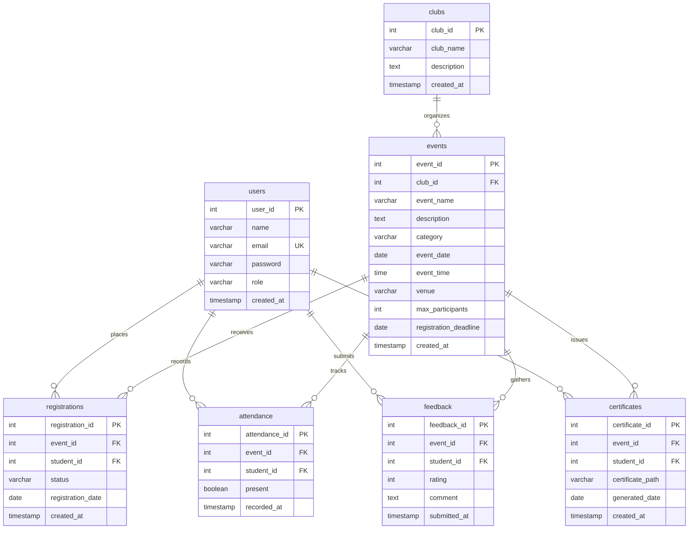

# Database Design: Campus Connect ◈
### Relational Schema Specification, Entity-Relationship Diagram & Constraints

**Primary Live Engine:** Supabase PostgreSQL (PostgreSQL 15 / 16 / 17 via Session Pooler with SSL)
**Alternative Engine:** MySQL 8.0+ / MariaDB 10.5+ (InnoDB Engine)
**Schema Definition (PostgreSQL):** [`database/schema_postgres.sql`](file:///home/sonya/Java_mini_ClubManagementSystem/database/schema_postgres.sql)
**Schema Definition (MySQL):** [`database/schema.sql`](file:///home/sonya/Java_mini_ClubManagementSystem/database/schema.sql)
**Safe Seed & Verification:** [`database/seed_minimal_safe.sql`](file:///home/sonya/Java_mini_ClubManagementSystem/database/seed_minimal_safe.sql), [`database/DEMO_DATA_SETUP.md`](file:///home/sonya/Java_mini_ClubManagementSystem/database/DEMO_DATA_SETUP.md)

---

## 1. Schema Overview

The database design for **Campus Connect** is strictly normalized to **Third Normal Form (3NF)** to eliminate data redundancy, prevent update anomalies, and enforce referential integrity across all student and administrative workflows.

The schema comprises **7 core normalized tables**:
1. `users` — Student and administrator identities with role discrimination (`chk_user_role`) and PBKDF2 password hashes.
2. `clubs` — Official campus clubs and societies.
3. `events` — Scheduled events created and owned by clubs, with date, time, venue, seat capacity, and registration deadlines.
4. `registrations` — Student event registrations with status checks (`chk_reg_status`) and duplicate prevention (`uq_registration_event_student`).
5. `attendance` — Verified participant attendance records gated on approved registration (`uq_attendance_event_student`).
6. `feedback` — Post-event qualitative reviews and 1–5 star ratings (`chk_feedback_rating`, `uq_feedback_event_student`).
7. `certificates` — Issued completion certificates with unique verification paths (`uq_cert_event_student`).

In addition, an idempotent audit tracking table (`_demo_setup_tracking`) is utilized by the safe fixture scripts to ensure repeatable, non-destructive demo setup and teardown.

---

## 2. Entity-Relationship (ER) Diagram



---

## 3. Detailed Table Specifications

### 3.1 Table: `users`
Stores user profile information for both students and campus administrators.

| Column Name | Data Type | Nullable | Key / Constraint | Description |
| :--- | :--- | :---: | :--- | :--- |
| `user_id` | `INT` | No | `PRIMARY KEY AUTO_INCREMENT` | Unique user identifier |
| `name` | `VARCHAR(100)` | No | — | Full name of the user |
| `email` | `VARCHAR(150)` | No | `UNIQUE` | Unique email for authentication |
| `password` | `VARCHAR(255)` | No | — | Salted PBKDF2WithHmacSHA256 self-describing hash (`PBKDF2WithHmacSHA256:<iter>:<salt>:<hash>`) |
| `role` | `VARCHAR(20)` | No | `CHECK (role IN ('STUDENT', 'ADMIN'))` | Role discriminator |
| `created_at` | `TIMESTAMP` | Yes | `DEFAULT CURRENT_TIMESTAMP` | Account creation timestamp |

- **Integrity Rule:** `chk_user_role` ensures no user can be registered with an arbitrary or unauthorized role string.
- **Security Rule (Phase 19B):** Passwords are never stored in plaintext. Passwords use PBKDF2-HMAC-SHA256 with a 16-byte cryptographically random salt, 65,536 iterations, 256-bit derived key, and constant-time verification. Legacy plaintext records undergo controlled on-the-fly upgrades upon successful login.

---

### 3.2 Table: `clubs`
Represents official student clubs and societies that organize events.

| Column Name | Data Type | Nullable | Key / Constraint | Description |
| :--- | :--- | :---: | :--- | :--- |
| `club_id` | `INT` | No | `PRIMARY KEY AUTO_INCREMENT` | Unique club identifier |
| `club_name` | `VARCHAR(100)` | No | — | Name of the club organization |
| `description` | `TEXT` | Yes | — | Mission statement and overview |
| `created_at` | `TIMESTAMP` | Yes | `DEFAULT CURRENT_TIMESTAMP` | Club record creation timestamp |

---

### 3.3 Table: `events`
Stores campus events organized by clubs, including scheduling, venue, and capacity quotas.

| Column Name | Data Type | Nullable | Key / Constraint | Description |
| :--- | :--- | :---: | :--- | :--- |
| `event_id` | `INT` | No | `PRIMARY KEY AUTO_INCREMENT` | Unique event identifier |
| `club_id` | `INT` | No | `FOREIGN KEY -> clubs(club_id)` | Organizing club reference |
| `event_name` | `VARCHAR(150)` | No | — | Official title of the event |
| `description` | `TEXT` | Yes | — | Detailed event overview |
| `category` | `VARCHAR(50)` | Yes | — | Category (e.g. Technology, Arts, Robotics, Business) |
| `event_date` | `DATE` | No | `INDEX (idx_events_date)` | Scheduled date of the event |
| `event_time` | `TIME` | Yes | — | Scheduled start time |
| `venue` | `VARCHAR(150)` | Yes | — | Physical hall or laboratory location |
| `max_participants` | `INT` | No | — | Maximum seating / attendance limit |
| `registration_deadline` | `DATE` | No | — | Last permissible date to register |
| `created_at` | `TIMESTAMP` | Yes | `DEFAULT CURRENT_TIMESTAMP` | Record creation timestamp |

- **Foreign Key Action:** `fk_events_club` (`ON UPDATE CASCADE ON DELETE RESTRICT`). Prevents deleting a club if it has associated scheduled events.
- **Indexes:**
  - `idx_events_date (event_date)` — Optimizes chronological sorting and calendar searches.
  - `idx_events_club (club_id)` — Optimizes filtering events by organizing club.

---

### 3.4 Table: `registrations`
Tracks student registrations for events and records administrative moderation status.

| Column Name | Data Type | Nullable | Key / Constraint | Description |
| :--- | :--- | :---: | :--- | :--- |
| `registration_id` | `INT` | No | `PRIMARY KEY AUTO_INCREMENT` | Unique registration record identifier |
| `event_id` | `INT` | No | `FOREIGN KEY -> events(event_id)` | Target event reference |
| `student_id` | `INT` | No | `FOREIGN KEY -> users(user_id)` | Registering student reference |
| `status` | `VARCHAR(20)` | No | `CHECK (status IN ('PENDING', 'APPROVED', 'REJECTED'))` | Moderation status |
| `registration_date` | `DATE` | No | — | Date the registration was submitted |
| `created_at` | `TIMESTAMP` | Yes | `DEFAULT CURRENT_TIMESTAMP` | Record creation timestamp |

- **Unique Constraint:** `uq_registration_event_student UNIQUE (event_id, student_id)`. Guarantees a student cannot register for the same event multiple times.
- **Foreign Key Actions:**
  - `fk_reg_event`: `ON UPDATE CASCADE ON DELETE RESTRICT`. Prevents deleting events that have student registrations.
  - `fk_reg_student`: `ON UPDATE CASCADE ON DELETE RESTRICT`. Prevents deleting student records with registration history.
- **Indexes:**
  - `idx_reg_student (student_id)` — Fast retrieval for the student's "My Events" view.
  - `idx_reg_event (event_id)` — Fast aggregation of registrations for admin event rosters.

---

### 3.5 Table: `attendance`
Records verified student presence at campus events.

| Column Name | Data Type | Nullable | Key / Constraint | Description |
| :--- | :--- | :---: | :--- | :--- |
| `attendance_id` | `INT` | No | `PRIMARY KEY AUTO_INCREMENT` | Unique attendance entry identifier |
| `event_id` | `INT` | No | `FOREIGN KEY -> events(event_id)` | Event reference |
| `student_id` | `INT` | No | `FOREIGN KEY -> users(user_id)` | Attending student reference |
| `present` | `BOOLEAN` | No | `DEFAULT FALSE` | Presence flag (`TRUE` = Present, `FALSE` = Absent) |
| `recorded_at` | `TIMESTAMP` | Yes | `DEFAULT CURRENT_TIMESTAMP` | Timestamp of attendance recording |

- **Unique Constraint:** `uq_attendance_event_student UNIQUE (event_id, student_id)`. Prevents duplicate attendance entries for a single student per event.
- **Foreign Key Actions:** `ON UPDATE CASCADE ON DELETE RESTRICT` on both `event_id` and `student_id`.
- **Indexes:**
  - `idx_att_student (student_id)` — Optimizes attendance lookups for certificate validation.
  - `idx_att_event (event_id)` — Optimizes attendance roster generation for event coordinators.

---

### 3.6 Table: `feedback`
Captures post-event student satisfaction ratings and qualitative reviews.

| Column Name | Data Type | Nullable | Key / Constraint | Description |
| :--- | :--- | :---: | :--- | :--- |
| `feedback_id` | `INT` | No | `PRIMARY KEY AUTO_INCREMENT` | Unique feedback record identifier |
| `event_id` | `INT` | No | `FOREIGN KEY -> events(event_id)` | Reviewed event reference |
| `student_id` | `INT` | No | `FOREIGN KEY -> users(user_id)` | Reviewing student reference |
| `rating` | `INT` | No | `CHECK (rating >= 1 AND rating <= 5)` | Numerical rating from 1 to 5 stars |
| `comment` | `TEXT` | Yes | — | Qualitative feedback comment |
| `submitted_at` | `TIMESTAMP` | Yes | `DEFAULT CURRENT_TIMESTAMP` | Feedback submission timestamp |

- **Unique Constraint:** `uq_feedback_event_student UNIQUE (event_id, student_id)`. Prevents review spam by restricting each student to one feedback submission per event.
- **Check Constraint:** `chk_feedback_rating` enforces valid rating boundaries strictly at the database layer.
- **Foreign Key Actions:** `ON UPDATE CASCADE ON DELETE RESTRICT` on both `event_id` and `student_id`.
- **Indexes:**
  - `idx_fb_event (event_id)` — Accelerates average rating calculations per event.
  - `idx_fb_student (student_id)` — Accelerates feedback status checks in the student portal.

---

### 3.7 Table: `certificates`
Maintains verified digital certificates issued to participating students.

| Column Name | Data Type | Nullable | Key / Constraint | Description |
| :--- | :--- | :---: | :--- | :--- |
| `certificate_id` | `INT` | No | `PRIMARY KEY AUTO_INCREMENT` | Unique certificate identifier |
| `event_id` | `INT` | No | `FOREIGN KEY -> events(event_id)` | Associated event reference |
| `student_id` | `INT` | No | `FOREIGN KEY -> users(user_id)` | Recipient student reference |
| `certificate_path` | `VARCHAR(500)` | Yes | — | Document path / digital hash identifier |
| `generated_date` | `DATE` | Yes | — | Official date of issuance |
| `created_at` | `TIMESTAMP` | Yes | `DEFAULT CURRENT_TIMESTAMP` | Record creation timestamp |

- **Unique Constraint:** `uq_cert_event_student UNIQUE (event_id, student_id)`. Prevents accidental multiple certificate issuances to the same student for the same event.
- **Foreign Key Actions:** `ON UPDATE CASCADE ON DELETE RESTRICT` on both `event_id` and `student_id`.
- **Indexes:**
  - `idx_cert_student (student_id)` — Optimizes the student's certificate gallery queries.
  - `idx_cert_event (event_id)` — Optimizes certificate status checks during administrative issuance.

---

## 4. Referential Actions & Data Integrity Architecture

### Why `ON DELETE RESTRICT`?
In `database/schema.sql`, all foreign keys utilize `ON DELETE RESTRICT`:
```sql
CONSTRAINT fk_reg_event FOREIGN KEY (event_id)
    REFERENCES events(event_id)
    ON UPDATE CASCADE
    ON DELETE RESTRICT
```
This is a critical architectural decision designed to **prevent cascade deletion anomalies**:
- An administrator cannot accidentally delete an event if students have registered, attended, submitted feedback, or received certificates for it.
- A user account cannot be deleted if historical participation records, audit trails, or certificates are associated with their ID.
- In `EventDAO.deleteEvent()`, before executing deletion, the system explicitly queries dependent tables and reports human-readable dependency counts if deletion is blocked.

### Composite Unique Constraints
Every child table tracking student participation (`registrations`, `attendance`, `feedback`, `certificates`) defines a composite unique constraint on `(event_id, student_id)`:
```sql
CONSTRAINT uq_registration_event_student UNIQUE (event_id, student_id)
CONSTRAINT uq_attendance_event_student   UNIQUE (event_id, student_id)
CONSTRAINT uq_feedback_event_student     UNIQUE (event_id, student_id)
CONSTRAINT uq_cert_event_student         UNIQUE (event_id, student_id)
```
This dual-layer protection guarantees that even under concurrent desktop operations or rapid repeated clicks, duplicate database records are physically impossible.

---

## 5. Summary of Schema Indexes

| Table | Index Name | Indexed Columns | Justification |
| :--- | :--- | :--- | :--- |
| `events` | `idx_events_date` | `(event_date)` | Speeds up upcoming event queries and monthly trend aggregations |
| `events` | `idx_events_club` | `(club_id)` | Speeds up joins between clubs and events |
| `registrations` | `idx_reg_student` | `(student_id)` | Fast lookup for "My Events" and student pulse metrics |
| `registrations` | `idx_reg_event` | `(event_id)` | Fast aggregation of approved seats and capacity checks |
| `attendance` | `idx_att_student` | `(student_id)` | Accelerates certificate eligibility checks |
| `attendance` | `idx_att_event` | `(event_id)` | Accelerates attendance roster generation |
| `feedback` | `idx_fb_event` | `(event_id)` | Accelerates average rating calculations |
| `feedback` | `idx_fb_student` | `(student_id)` | Accelerates check for whether student already submitted feedback |
| `certificates` | `idx_cert_student` | `(student_id)` | Accelerates loading student certificate galleries |
| `certificates` | `idx_cert_event` | `(event_id)` | Accelerates admin certificate issuance eligibility checks |
